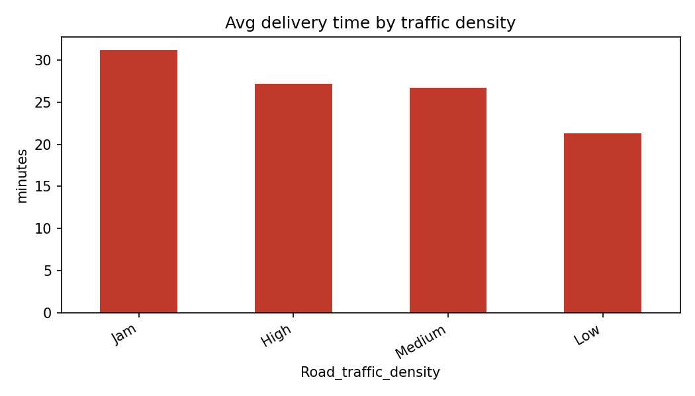
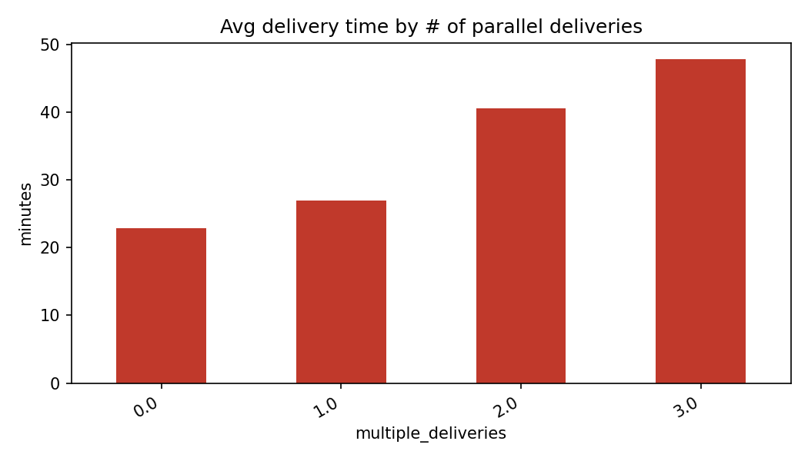
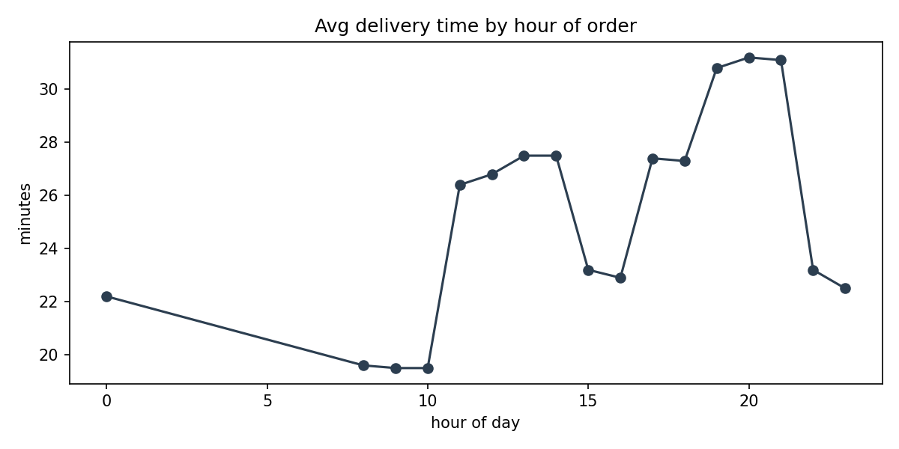

# Food Delivery Time Analysis

Analysis of 45,593 food delivery orders to find what drives delivery delays.

**Dataset:** Kaggle "Food Delivery Dataset" (gauravmalik26)
**Tools:** Python, Pandas, NumPy, Matplotlib

## What I did
- Cleaned the data and engineered features (haversine distance, order hour, late-delivery flag)
- Analysed delivery time by traffic, weather, distance, rider rating, parallel deliveries and hour of day
- "Late" is defined as a delivery taking more than 30 minutes

## Key findings
- Average delivery time: 26.3 min; 29.8% of orders took over 30 min
- Parallel deliveries were the strongest correlate of delivery time (r = 0.39); riders carrying 3 orders averaged 47.8 min
- Heavy traffic ("Jam"): average 31.2 min, 50.6% of orders over 30 min
- Riders rated 3.5 or below averaged 36.0 min
- Slowest hour: 8 PM (31.2 min average)

Note: these are correlations, not proof of cause.

## Charts

## Run it
pip install pandas numpy matplotlib
python delivery_analysis.py train.csv
